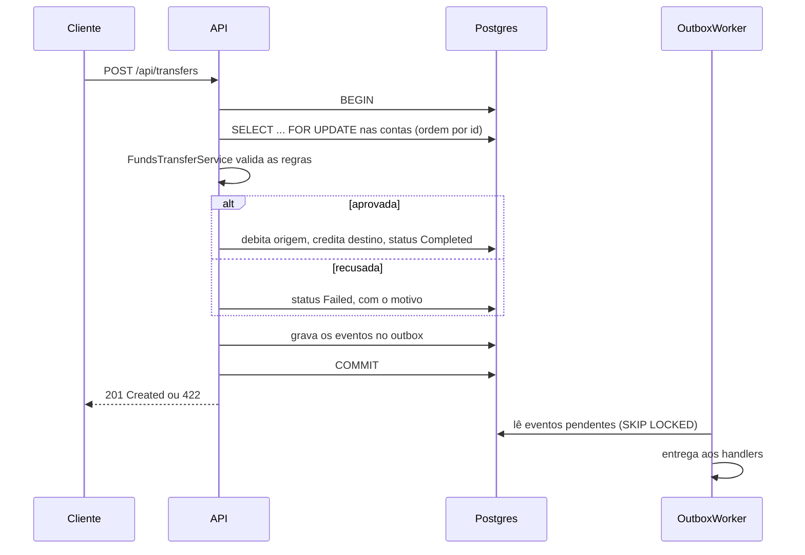

# Transferências Financeiras

Teste técnico para **Desenvolvedor .NET Pleno**: uma API REST e uma interface web para realizar, agendar, consultar e cancelar transferências entre contas. O sistema trata cheque especial, limites por hora diferentes de dia e de noite, e transferências simultâneas.

| | |
| --- | --- |
| **Backend** | .NET 10, ASP.NET Core, EF Core 10, PostgreSQL 17, Swagger: [`backend/`](backend/README.md) |
| **Frontend** | React 19, TypeScript, Vite, React Router: [`frontend/`](frontend/README.md) |
| **Testes** | 111 de unidade e integração (xUnit + Testcontainers) e 19 cenários e2e (Playwright, desktop e mobile) |
| **Infra** | Docker Compose; um comando sobe tudo |

## Como executar

Pré-requisitos:

- **Docker** com Compose v2 (Docker Desktop 4.x ou Docker Engine com o plugin `docker compose`). Nada mais precisa estar instalado.
- **`make`** é opcional. Cada comando do `make` tem o equivalente em `docker compose` logo abaixo.

```bash
docker compose up -d --build --wait
# ou: make up
```

| O quê | Endereço |
| --- | --- |
| Frontend | http://localhost:15173 |
| Swagger (API) | http://localhost:15080/swagger |
| Health check | http://localhost:15080/health |

As migrations são aplicadas quando a API sobe, e o banco recebe contas e transferências de demonstração. Para mudar portas, senha ou desligar os dados de demonstração, copie `.env.example` para `.env` e ajuste. Todas as variáveis têm valor padrão, então o `.env` é opcional.

### Comandos (`make`)

| Comando | Equivalente sem `make` | O que faz |
| --- | --- | --- |
| `make up` | `docker compose up -d --build --wait` | builda e sobe Postgres, API e frontend |
| `make down` | `docker compose down` | para os containers (o banco é mantido) |
| `make reset` | `docker compose down --volumes` + `up` | **apaga o banco** e sobe tudo de novo com os dados de demonstração |
| `make logs` | `docker compose logs -f api web` | acompanha os logs da API e do frontend |
| `make test` | — | roda **todos** os testes: backend e e2e |
| `make test-backend` | — | testes de unidade e integração (Postgres descartável via Testcontainers) |
| `make e2e` | — | testes e2e num ambiente isolado (projeto `transferencias-e2e`, portas próprias), destruído no final |

`backend/` e `frontend/` também têm `docker-compose.yml` e `Makefile` próprios, para trabalhar em cada parte separadamente.

## Roteiro de avaliação (5 minutos)

1. **Abra o frontend** em http://localhost:15173. A tela inicial lista as contas de demonstração, com saldo, cheque especial e valor disponível.
2. **Veja uma conta.** Clique em *Ana Souza*: saldo de -R$ 150, cheque especial de R$ 1.000 e disponível de R$ 850. Os limites por hora aparecem na mesma tela.
3. **Use o cheque especial.** Clique em **Transferir**, escolha *Bruno Lima* como destino e digite R$ 600. A transferência é concluída, o saldo de Ana vai para -R$ 750 e o disponível cai para R$ 250.
4. **Force uma recusa.** Tente transferir R$ 500 da mesma conta. Ela é recusada por saldo insuficiente, e a tentativa fica registrada como *Falhou*, com o motivo e um link para a tentativa.
5. **Agende e cancele.** Faça uma transferência com a opção *Agendar para uma data futura* e depois cancele o agendamento na tela de detalhes.
6. **Confira no Swagger.** Em http://localhost:15080/swagger, execute `GET /api/transfers` para ver as mesmas transferências na API.

## Exemplos com `curl`

Os IDs das contas são gerados quando o banco é criado. Liste-os primeiro:

```bash
curl -s http://localhost:15080/api/accounts | grep -o '"id":"[^"]*","holderName":"[^"]*"'
```

Transferência imediata (troque os IDs pelos das contas listadas):

```bash
curl -s -X POST http://localhost:15080/api/transfers \
  -H 'Content-Type: application/json' \
  -H "Idempotency-Key: $(uuidgen)" \
  -d '{"sourceAccountId":"<id-da-origem>","destinationAccountId":"<id-do-destino>","amount":100}'
```

- **`201 Created`**, com `"status":"Completed"`: a transferência foi feita.
- **`422 Unprocessable Entity`**: recusada por regra de negócio (saldo, limite, conta inativa). O corpo traz a transferência com `"status":"Failed"` e o motivo.
- **`400` ou `404`**: dados inválidos ou conta inexistente. Nenhuma tentativa é registrada nesses casos.

Agendamento (a data precisa estar no futuro):

```bash
curl -s -X POST http://localhost:15080/api/transfers/scheduled \
  -H 'Content-Type: application/json' \
  -d '{"sourceAccountId":"<id-da-origem>","destinationAccountId":"<id-do-destino>","amount":250,"scheduledFor":"2026-12-01T10:00:00-03:00"}'
```

Cancelamento (só funciona enquanto a transferência está `Scheduled`):

```bash
curl -s -X POST http://localhost:15080/api/transfers/<id-da-transferencia>/cancel
```

## Dados de demonstração

Criados na primeira subida, quando `RUN_SEEDS=true` (padrão). A coluna **Saldo inicial** é o valor de abertura; as transferências de demonstração já alteram o saldo, então os valores que você verá na tela são outros.

| Conta | Saldo inicial | Cheque especial | Status | Para testar |
| --- | --- | --- | --- | --- |
| Ana Souza | R$ 500 | R$ 1.000 | Ativa | Uso do cheque especial e transferências recusadas por saldo |
| Bruno Lima | R$ 2.000 | R$ 1.000 | Ativa | Destino de transferências |
| Carla Mendes | R$ 15.000 | R$ 0 | Ativa | Limite de valor por hora (diurno R$ 5.000 e 5 tentativas) e um agendamento futuro |
| Diego Rocha | R$ 1.200 | R$ 500 | Ativa | Transferências entre contas comuns |
| Elisa Martins | R$ 300 | R$ 2.000 | Ativa | Cheque especial alto |
| Fábio Teixeira | R$ 800 | R$ 300 | **Bloqueada** | Conta bloqueada não envia nem recebe |
| Gabriela Nunes | R$ 50 | R$ 0 | **Inativa** | Conta inativa não envia nem recebe |

Também existem quatro transferências já concluídas e dois agendamentos futuros, para as listas não começarem vazias. Recusas aparecem quando você as provoca, como no passo 4 do roteiro.

## Estrutura

```
.
├── docker-compose.yml        # banco + API + frontend
├── backend/
│   ├── src/
│   │   ├── Transfers.Domain/          # agregados, regras, eventos (sem dependências)
│   │   ├── Transfers.Application/     # casos de uso (handlers), portas, apresentação
│   │   ├── Transfers.Infrastructure/  # EF Core, Postgres, travas, outbox, workers, seeds
│   │   └── Transfers.Api/             # controllers, Swagger, ProblemDetails
│   └── tests/                         # unidade + integração com Postgres real
└── frontend/
    ├── src/                           # páginas, componentes, cliente da API
    └── e2e/                           # Playwright
```

## Como uma transferência acontece



Se duas transferências usam o mesmo saldo ao mesmo tempo, a segunda espera o `FOR UPDATE` da primeira e lê o saldo já atualizado. O detalhamento está no [README do backend](backend/README.md#concorrência-duas-transferências-ao-mesmo-tempo).

## Requisitos do enunciado

| Requisito | Como foi atendido |
| --- | --- |
| Transferir, agendar, consultar e cancelar | `POST /api/transfers`, `POST /api/transfers/scheduled`, `GET /api/transfers/{id}`, `POST /api/transfers/{id}/cancel`, com as telas correspondentes |
| Conta com saldo e cheque especial configurável | `GET /api/accounts/{id}`, `PUT /api/accounts/{id}/overdraft-limit`; um CPF, uma conta |
| Conta bloqueada/inativa não envia nem recebe | Recusado na transferência imediata, **no agendamento** e de novo na execução do agendamento |
| Origem ≠ destino, valor > 0, saldo + cheque especial | Validado no domínio e reforçado por `CHECK` constraints no banco |
| Débito e crédito atômicos | Uma transação por operação; o dinheiro só se move pelo `FundsTransferService` |
| Recebimento cobre primeiro o cheque especial | Saldo único que pode ser negativo: `-800 + 1000 = 200` |
| Limite de valor e de tentativas por hora, dia ≠ noite, recusas contam | Janela deslizante de 60 min; toda recusa é gravada como `Failed`. Limites editáveis por conta |
| Agendamento: data futura, cancelável, revalidado na execução | Worker em background com `FOR UPDATE SKIP LOCKED`; as mesmas regras da transferência imediata |
| Status Scheduled, Processing, Completed, Failed, Cancelled | Máquina de estados explícita no agregado `Transfer` |
| .NET 8+, REST, EF Core com banco relacional, Swagger | .NET 10, PostgreSQL, migrations versionadas, `/swagger` |
| Duas transferências simultâneas | Trava pessimista ordenada por id (sem deadlock), token otimista e testes de concorrência |
| README, migrations, decisões arquiteturais | Este arquivo e o [README do backend](backend/README.md#decisões-arquiteturais) |

### Diferenciais

| Diferencial | Situação |
| --- | --- |
| Docker | ✅ Um `docker compose up` sobe tudo; imagens com healthcheck e limites de recurso |
| Testes de integração | ✅ API real contra Postgres real (Testcontainers), com relógio controlado |
| Background worker para agendamentos | ✅ `ScheduledTransfersWorker`, seguro com várias instâncias |
| Domain Events | ✅ Gravados num **outbox transacional** e entregues por um worker (*at-least-once*, com retentativa) |
| Idempotência | ✅ Header `Idempotency-Key`; o frontend envia uma chave por envio do formulário |
| Mensageria | ◑ O outbox é a base: publicar em RabbitMQ/Kafka é só adicionar um handler. Não há broker no compose, para manter a solução simples |

## Principais decisões

Detalhes e justificativas estão no [README do backend](backend/README.md#decisões-arquiteturais). Em resumo:

- **Clean Architecture com DDD:** o domínio não depende de nada; regras ficam nos agregados (`Account`, `Transfer`) e num serviço de domínio (`FundsTransferService`). Os controllers não têm regra de negócio.
- **Toda tentativa vira registro:** uma recusa por regra de negócio é gravada como `Failed`, com o motivo. É assim que as recusas contam para o limite de tentativas, e o usuário consegue consultar o que aconteceu.
- **Concorrência resolvida no banco:** `SELECT … FOR UPDATE` nas contas, sempre na mesma ordem, dentro de uma transação. A segunda transferência que usa o mesmo saldo espera a primeira terminar e enxerga o saldo atualizado.
- **Erros esperados como `Result`**, não exceções; respostas de erro em RFC 7807 (`ProblemDetails`) com mensagens em pt-BR.
- **Frontend sem regra de negócio:** a API devolve valores formatados, rótulos, cores de status e as ações permitidas. Ordenação, filtro e paginação acontecem no servidor.

## Limitações conhecidas

Decisões de escopo que um avaliador deve conhecer:

- **Sem autenticação.** Qualquer cliente pode movimentar qualquer conta. Em produção, isso exigiria login e autorização por titular.
- **O status `Processing` não é observável pela API.** Ele existe no domínio, mas a transição acontece dentro da mesma transação que liquida a transferência. A justificativa está no [README do backend](backend/README.md#decisões-arquiteturais).
- **Outbox sem broker.** Os eventos são gravados e entregues, mas não há RabbitMQ ou Kafka no compose.
- **Fuso e horários fixos.** O fuso (`America/Sao_Paulo`) e os inícios de dia (06:00) e de noite (22:00) ficam no `appsettings.json`. Os limites por hora podem ser alterados por conta, mas os horários não.

## Solução de problemas

| Sintoma | Causa provável | O que fazer |
| --- | --- | --- |
| `port is already allocated` ao subir | Outro programa, ou um ambiente antigo, usa 15080, 15173 ou 15432 | Mude `API_PORT`, `WEB_PORT` ou `DB_PORT` no `.env` e rode de novo. Confira com `docker ps` |
| Frontend mostra "Carregando…" para sempre | A API ainda não está pronta, ou o banco não subiu | Rode `make logs` e veja se a API chegou a `Application started`. Teste http://localhost:15080/health |
| Contas ou transferências antigas aparecem | O banco guardou dados de uma subida anterior | Rode `make reset`. Atenção: isso apaga os dados do banco |
| `make: command not found` | `make` não está instalado (opcional) | Use os comandos equivalentes da tabela de comandos |
| A página de nova transferência fica em branco ao abrir pelo IP da rede | Navegador sem contexto seguro (HTTPS ou localhost) | Já tratado: a chave de idempotência usa um gerador alternativo. Se persistir, atualize o frontend com `make up` |
